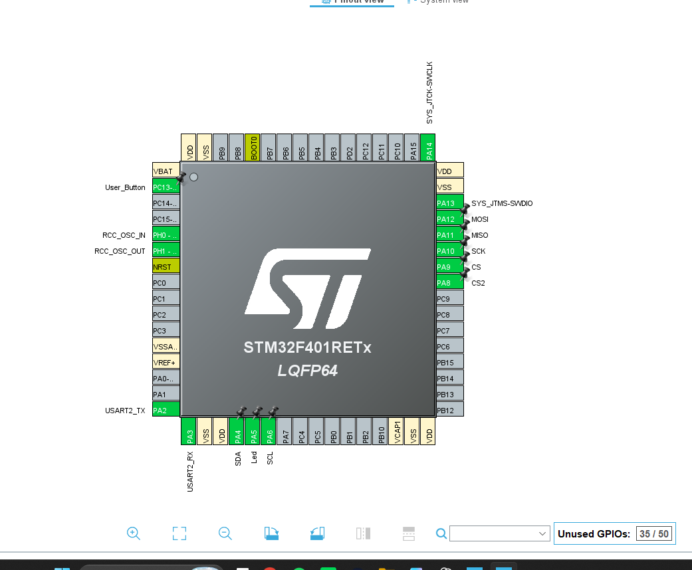
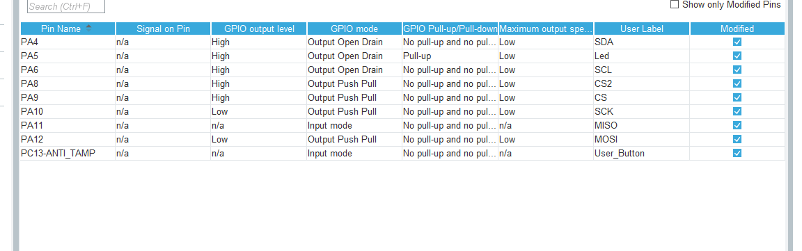
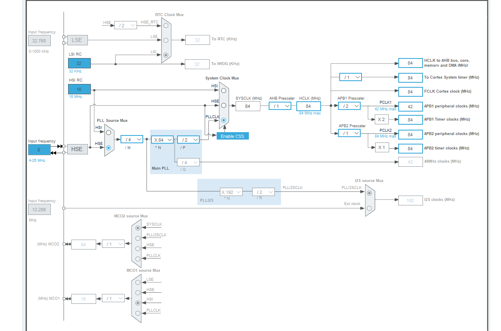
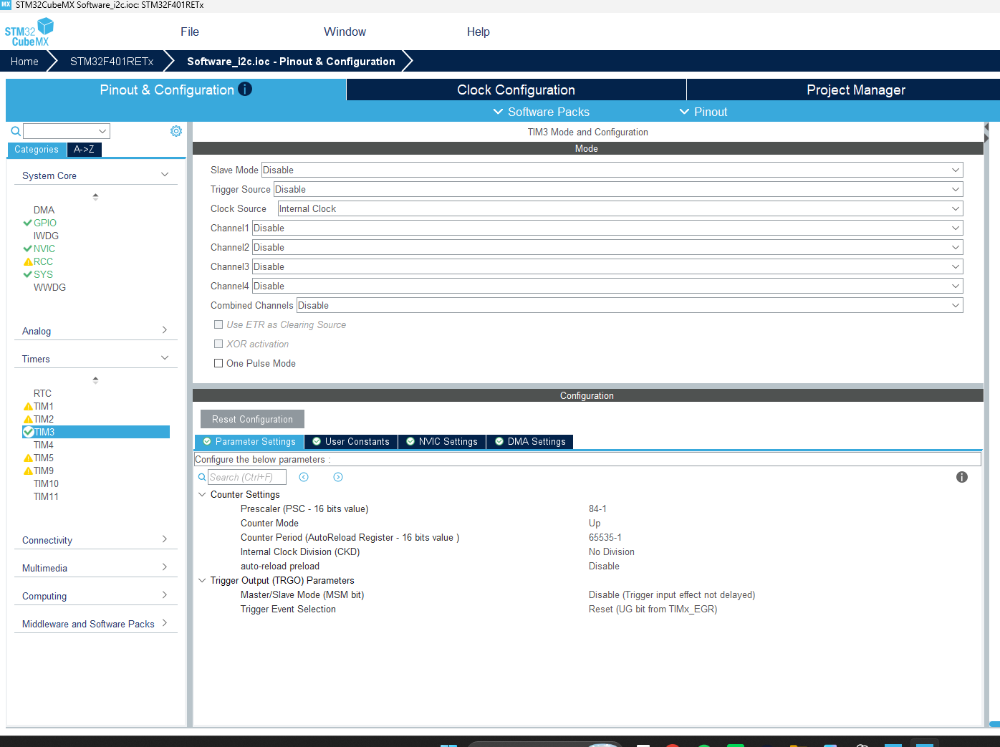

# STM32F401RE ile Yazılımsal I²C ve SPI

Bu projede STM32F401RE üzerinde GPIO pinlerini kullanarak I²C ve SPI haberleşmesini yazılımsal olarak gerçekleştirdim. Master kart, seri terminalden aldığı komuta göre iki SPI cihazına LED açma veya kapatma komutu gönderiyor. Ayrıca I²C üzerinden `0x28` adresindeki cihazdan bir bayt okuyarak LED durumunu terminale yazdırıyor.

## Seri terminalden LED kontrolü

Seri terminali **115200 baud, 8 veri biti, parite yok, 1 stop biti (8N1)** olarak ayarlayın. Satır sonu olarak **CR+LF** seçin. Program 10 bayt bekler. Örneğin `led on 2` komutu, sekiz karakter ve iki satır sonu karakteriyle 10 baytı tamamlar.

| Terminal komutu | 1. cihaz (CS / PA9) | 2. cihaz (CS2 / PA8) |
|---|---|---|
| `led on 0` | Kapat | Kapat |
| `led on 1` | Aç | Kapat |
| `led on 2` | Kapat | Aç |
| `led on 3` | Aç | Aç |

Master, SPI üzerinden **aç** komutu için `0x01`, **kapat** komutu için `0x02` gönderir. İki cihaz SCK ve MOSI hatlarını paylaşır. Master, hangi cihaza veri gönderecekse o cihazın CS pinini düşük seviyeye çeker.

I²C okumasında `0x01` değeri terminalde `Led Yandi`, `0x02` değeri ise `led yanmiyor` olarak gösterilir. Mevcut örnekte okuma başarısız olduğunda önceki LED durumu tekrar görünebilir.

## Master kartın pin bağlantıları

| İşlev | Master pini | Kullanım |
|---|---|---|
| I²C SDA | PA4 | Çift yönlü veri hattı |
| I²C SCL | PA6 | I²C saat hattı |
| SPI SCK | PA10 | İki cihazın ortak saat hattı |
| SPI MOSI | PA12 | Master’dan cihazlara veri gönderimi |
| SPI MISO | PA11 | Giriş olarak ayarlı, bu örnekte kullanılmıyor |
| SPI CS | PA9 | Birinci cihaz seçimi |
| SPI CS2 | PA8 | İkinci cihaz seçimi |
| USART2 TX / RX | PA2 / PA3 | Seri terminal bağlantısı |
| LED | PA5 | Master kart üzerindeki LED |
| Kullanıcı butonu | PC13 | PA5 üzerindeki LED’in durumunu değiştirir |

### GPIO ayarları

SDA ve SCL pinleri **open-drain** çıkış olarak ayarlı ve dahili pull-up dirençleri kapalı. Devreyi kurarken her iki I²C hattında da pull-up direnci bulunduğundan ve kartların GND uçlarının ortak olduğundan emin olun. SPI tarafında CS ve CS2 başlangıçta yüksek, SCK ve MOSI düşük seviyededir.

## Saat ayarları ve TIM3

**8 MHz HSE** kaynağından PLL ile **84 MHz sistem saati** elde ediliyor. APB1 çevre birimi saati **42 MHz**, APB1 üzerindeki TIM3’ün giriş saati ise **84 MHz**.

TIM3 prescaler değeri `84 - 1` olarak ayarlandı. Böylece 84 MHz giriş saati 84’e bölünüyor ve sayaç **her 1 µs’de bir** artıyor. `mikrosaniye_timer()` fonksiyonu, I²C ve SPI sinyallerini üretirken gereken bekleme sürelerini bu sayaçla ölçüyor.

## Kaynak dosyalar

| Dosya | İçerik |
|---|---|
| `main.c` | UART komutları, SPI cihaz seçimi, I²C durum okuması ve buton kontrolü |
| `software_i2c.c` | Yazılımsal I²C gönderme ve okuma işlemleri, slave tarafında veri gönderimi ve TIM3 zamanlaması |
| `software_i2c.h` | I²C fonksiyon bildirimleri ve haberleşme durumunu tutan veri yapısı |
| `software_spi.c` | GPIO üzerinden en yüksek bitten başlayarak bir bayt SPI verisi gönderme |
| `software_spi.h` | SPI fonksiyon bildirimleri |
